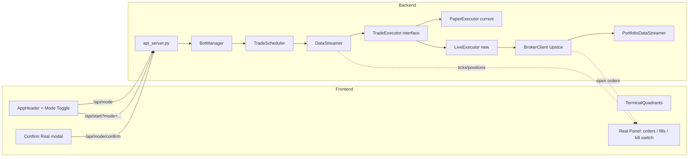

# Real Trading Mode — Plan

## Goal

Add a **Real / Paper trading switch** to the existing dashboard. One bot process, one UI, one toggle that swaps the **data source** between the current paper DB and a new live-broker path. Paper keeps doing what it does. Real talks to Upstox and uses broker-side SL-L orders.

## Current strategy recap (what real mode must replicate)

The bot runs **Red Candle High Break** ([`backend/strategies/red_candle_high_break.py`](file:///c:/Users/Pravin/Desktop/main/option-trading-bot/backend/strategies/red_candle_high_break.py:1)):

1. Wait for a red candle (open > close) to close → becomes the **reference candle** with high `H`.
2. On the next candle(s), if `LTP > H` → **entry signal**. Paper entry price is set to `H` (not LTP) to match backtest.
3. `max_wait_candles` (default 2) — after that, reference expires.
4. `allow_reference_shift` (default true) — if a _newer_ red candle closes while waiting, the reference shifts to it and the wait counter resets.
5. On entry → `PositionManager.open_position(entry_price=H)`, initial SL = `H - initial_sl_points` (default 4).
6. Trailing: when profit ≥ `trailing_trigger` (5), step `trailing_step` (5) → move SL up, never down.
7. Manual SL drag via [`PriceDiagram`](file:///c:/Users/Pravin/Desktop/main/option-trading-bot/frontend/app/components/PriceDiagram.tsx:1) → `modifySl` API → `data_streamer.modify_sl` → `pm.set_manual_sl`. Currently sets in-memory only.
8. Manual close via the floating panel → `closePosition` API → `data_streamer.close_position_manual` → `exit_position` with last LTP. Also in-memory only today.

**Real-mode key insight**: in paper mode entry is "free" at exactly `H`. In real mode the SL-L fills at `limit_price = H + buffer_pts` (which is _above_ H). So the real `entry_price` recorded for P&L = the broker fill price, not the reference high. This naturally changes P&L distribution vs paper — call this out in the runbook.

## Confirmed decisions (locked)

- **UI**: one dashboard, one toggle in the header (Paper / Real). Real mode adds a red banner + a separate right-side panel for broker state. Same quadrant layout on both.
- **Entry**: real SL-L order placed at candle close (`trigger = high`, `limit = high + buffer_pts`). On next candle close, check status → cancel if still pending. If still trigger-pending after `entry_reprice_after_s` (default 10s) → cancel + place fresh LIMIT at current LTP + buffer.
- **Reference shift**: when `allow_reference_shift` and a newer red candle closes while waiting, cancel the old pending entry SL-L, wait for cancel confirmation, then place a new SL-L at the new candle's high. Runs in `on_candle_closed` (a red candle can only be confirmed at close).
- **Trailing**: simple 5-pt step — keep current logic, just call `modify-order` whenever `update_trailing_sl` returns `True`. Candle-close based, not tick-based.
- **Manual SL drag** (PriceDiagram) goes through the same `modify-order` path.
- **Manual close** (floating panel) cancels the SL order + places a **LIMIT SELL** (preferred over MARKET). Exit is recorded when the exit order's fill arrives via PortfolioDataStreamer WebSocket. Fall back to MARKET only if LIMIT doesn't fill in a few seconds.
- **Auth**: reuse the existing `access_token` from settings. No new keys. A "Confirm Real Trading" checkbox in the UI must be ticked before the mode can flip to Real. Plus a "Really go live?" second confirmation on the first real order each trading day.
- **Intraday, Nifty options**. Product = `I` (intraday). Validity = `DAY`. Lot size = 65.
- **Real dashboard extra info**: open broker orders + IDs, fill vs intended, partial fills, broker reject reasons, ₹ P&L after charges, kill-switch.
- **P&L caveat**: real entry is at the SL-L fill price (≥ `H + buffer_pts`), not `H`. Recorded entry_price is the broker fill. P&L distribution will differ slightly from paper — call this out in the runbook.

## Guider's locked-in answers (do not change without strong reason)

| Topic           | Decision                                                                                 |
| --------------- | ---------------------------------------------------------------------------------------- |
| Fill detection  | **PortfolioDataStreamer (WebSocket, primary) + candle-close backup**                     |
| Partial fills   | **Accept filled qty + cancel remainder; track `filled_qty` permanently**                 |
| Gap on entry    | **Wider buffer (default 2.5 pts) + 10s re-price to LIMIT; then natural cancel on close** |
| EOD square-off  | **Bot forces exit at 15:15 (hard kill-switch at 15:25)**                                 |
| Trailing        | **Manual Modify (5-pt step, candle-close based)**                                        |
| SL direction    | **Hard "never widen" rule** — `new_trigger = max(old, calculated)` (longs)               |
| Lot size        | **65** (from settings; sample code in doc was wrong with 75)                             |
| Buffer          | **2.5 pts** default (configurable `buffer_pts`)                                          |
| Order endpoints | `OrderApiV3.place_order` (v3) + `OrderApi` (v2) for cancel/modify/status                 |
| Fill WebSocket  | `PortfolioDataStreamer` (`order_update=True`) running the whole day                      |
| Reference shift | **Sequential**: cancel → wait confirm → then place new SL-L                              |
| Manual close    | **LIMIT SELL** at LTP – buffer; fallback to MARKET after a few seconds                   |
| State machine   | `IDLE → WAITING_ENTRY → IN_POSITION → EXITING` per slot                                  |
| Bot stop        | **Cancel all pending entry SL-L** when bot stops or mode flips back to Paper             |
| Race protection | Always re-fetch order status immediately before any cancel/modify                        |
| Rate limit      | In-memory counter, max ~8 calls/sec (under SEBI's 10/sec)                                |
| Daily live gate | Second "Really go live?" confirmation on first real order each trading day               |
| Static IP       | Required from April 2026 (operational requirement, not code)                             |
| Sandbox default | `sandbox=True` for first run; flip to prod via setting after runbook passes              |
| Order logging   | Every order_id + status transition with timestamps                                       |

## New settings to add

| Key                     | Type    | Default | Purpose                                              |
| ----------------------- | ------- | ------- | ---------------------------------------------------- |
| `trading_mode`          | select  | `paper` | `paper` or `real`                                    |
| `confirm_real_trading`  | boolean | `false` | UI gate; backend re-checks on every start            |
| `daily_live_confirmed`  | boolean | `false` | Second "Really go live?" gate; reset at start of day |
| `sandbox_enabled`       | boolean | `true`  | `sandbox.upstox.com` for first real-mode runs        |
| `buffer_pts`            | number  | `2.5`   | SL-L limit = trigger + buffer_pts                    |
| `entry_reprice_after_s` | number  | `10`    | Re-price unfilled SL-L after N seconds               |
| `eod_force_exit_time`   | time    | `15:15` | Bot calls kill-switch at this time                   |
| `eod_hard_kill_time`    | time    | `15:25` | Last-resort kill-switch                              |
| `use_portfolio_stream`  | boolean | `true`  | Use PortfolioDataStreamer for order fills            |
| `max_orders_per_sec`    | number  | `8`     | Stay under SEBI's 10/sec                             |

## Answers for the doc's open questions (give these to the guider)

1. **Language** → Python (the bot is already Python).
2. **Intraday or delivery?** → Intraday (Nifty options, square off EOD).
3. **Exact trailing method?** → Simple 5-pt step (current `trailing_step` in settings).
4. **Auth/token already handled?** → Yes — same `access_token` used for the market feed will be used for orders. Need a "Confirm Real Trading" gate in the UI as a safety check (not an Upstox requirement).
5. **Specific instrument?** → Nifty options (NIFTY index, weekly expiry CE/PE), `NSE_FO` segment.

## Architecture



## Real-mode entry/exit lifecycle (per slot)

```mermaid
sequenceDiagram
  autonumber
  participant S as Strategy
  participant DS as DataStreamer
  participant TE as LiveExecutor
  participant BC as BrokerClient
  participant PM as PositionManager
  participant WS as PortfolioDataStreamer

  Note over S,DS: Candle N closes → red
  S->>S: reference_candle=N, counter=0
  DS->>TE: on_candle_closed(reference)
  TE->>BC: place SL-L BUY (trigger=N.high, limit=N.high+2.5pts)
  BC-->>TE: entry_order_id

  Note over BC,WS: PortfolioDataStreamer runs all day (primary fill path)
  WS->>TE: on_order_update(event)
  Note over TE: Primary fill detection

  Note over S,DS: Candle N+1 closes
  S->>S: counter=1
  alt Candle N+1 is red AND allow_reference_shift
    S->>S: reference shifts to N+1
    DS->>TE: on_reference_shifted(old_id, new_ref)
    TE->>BC: cancel_order(old_entry_id)
    Note over TE: Wait for cancel confirmation, then:
    TE->>BC: place SL-L (trigger=N+1.high, limit=+2.5pts)
  else Not shifted
    DS->>TE: on_candle_closed(check pending)
    TE->>BC: get_order_status(entry_order_id)
    alt status == filled
      TE->>PM: open_position(fill_price=broker_fill, filled_qty)
      TE->>BC: place SL-L SELL (trigger=sl, limit=sl-2.5pts)
      BC-->>TE: sl_order_id
    else status == trigger pending > 10s
      TE->>BC: cancel_order(entry_order_id)
      TE->>BC: place LIMIT BUY (price=current_ltp + 2.5pts)
      Note over TE: Re-price attempt; if still no fill by next candle close → cancel
    else status == open or trigger pending < 10s
      Note over TE: Wait, re-check on next candle close or timer
    else status == rejected
      Note over TE: Log + skip
    end
  end

  Note over PM,BC: While in position
  PM->>PM: update_trailing_sl(ltp) on each tick
  alt sl_moved
    DS->>TE: on_sl_changed(new_sl)
    TE->>BC: modify_order(sl_order_id, trigger=new_sl)
  end

  Note over DS,BC: Manual SL drag (PriceDiagram)
  DS->>TE: on_manual_sl(new_sl)
  TE->>BC: modify_order(sl_order_id, trigger=new_sl)

  Note over DS,BC: Manual close (floating panel)
  DS->>TE: on_manual_close()
  TE->>BC: cancel_order(sl_order_id)
  TE->>BC: place LIMIT SELL (price=ltp - 2.5pts) preferred over MARKET
  Note over TE: If LIMIT not filled in a few seconds → try MARKET
  Note over WS: WS on_order_update → fill → exit_position(fill_price)

  Note over DS,BC: Bot stopped or mode flipped to Paper
  DS->>TE: on_bot_stop()
  TE->>BC: cancel_order(all pending entry SL-L ids)

  Note over S,DS: EOD 15:15
  DS->>TE: kill_switch()
  TE->>BC: cancel all open orders
  TE->>BC: place LIMIT EXIT for all positions
  Note over WS: WS fills → exit_position recorded

  Note over S,DS: EOD 15:25 (hard kill)
  DS->>TE: force_exit_all(ltp)
  TE->>BC: market exit all positions
```

**Key constraints (the bits the doc didn't cover)**:

- A "newer red candle" can ONLY be known at candle close. So reference shift fires inside `on_candle_closed` (the same code path that calls `strategy.on_new_candle_closed`), not on a tick.
- Real entry price is the **broker fill price** (≥ `H + buffer_pts`), not `H`. Record fill price in DB, not reference high.
- SL order is **SELL SL-L** (opposite side) with `trigger=sl, limit=sl-buffer_pts`. Buffer = 2.5 pts default.
- Manual SL via `PriceDiagram` drag must always call `modify-order` on the live SL order in real mode. Auto-trailing SL and manual SL share the same modify path.
- Manual close in real mode = `cancel_order(sl_order_id)` + place a **LIMIT SELL** (preferred over MARKET). Trade's exit recorded when exit order fills via PortfolioDataStreamer.
- **Never widen SL**: `new_trigger = max(old_trigger, calculated_new)` for long positions; `min(old_trigger, calculated_new)` for short. Non-negotiable.
- **Partial fill**: accept filled qty, cancel remainder, track `filled_qty` permanently for all subsequent SL and exit orders.
- **Reference shift**: cancel old entry SL-L first → wait for cancel confirmation → place new SL-L. Avoids two live entry orders simultaneously.
- **State machine per slot**: `IDLE → WAITING_ENTRY → IN_POSITION → EXITING`.
- **When bot stops or mode → Paper**: immediately cancel all pending entry SL-L orders.
- **Re-price timeout**: after SL-L triggers, if unfilled after 10s → cancel + place LIMIT at current LTP + 2.5pts. If still no fill by next candle → cancel.
- **LIMIT exit over MARKET**: prefer LIMIT SELL at LTP – 2.5pts; fall back to MARKET only if LIMIT doesn't fill within a few seconds.
- **WebSocket is primary, candle-close is backup**: PortfolioDataStreamer (`order_update=True`) is the main fill path. Candle-close polling only catches disconnects.
- **Rate limit**: simple in-memory counter, max ~8 calls/sec. Reset every 1s window.
- **Daily live gate**: second "Really go live?" confirmation on the first real order each trading day.
- **Order logging**: every order_id + status transition logged with timestamps. Critical for debugging real fills.

## Partial Fill Handling (detailed spec)

### Goal

When an SL-L entry order receives a **partial fill**, treat the filled quantity as the real position size, immediately cancel the unfilled remainder, and place the protective SL only for the filled quantity. Never leave a dangling partial order.

### Exact behaviour

1. **Detection**
   - Primary: `PortfolioDataStreamer` `order_update` event where `status == "complete"` or `"partially filled"` and `filled_quantity > 0`.
   - Backup: on candle close, call `get_order_details(entry_order_id)` and inspect `filled_quantity` vs `quantity`.

2. **On partial fill (or full fill)**

   ```python
   filled_qty = order.filled_quantity          # e.g. 65, 130, 45
   remaining_qty = order.quantity - filled_qty
   if remaining_qty > 0:
       cancel_order(entry_order_id)            # cancel the unfilled portion
       # Wait for cancel confirmation (or fire-and-forget with log)
   ```

3. **Position opening**

   ```python
   pm.open_position(
       instrument_token=...,
       side="BUY",                             # or SELL for PE
       quantity=filled_qty,                    # ← use filled_qty, never original
       entry_price=order.average_price,        # broker fill price
       ...
   )
   position.filled_qty = filled_qty            # store permanently
   ```

4. **Initial SL placement**
   - Place SELL SL-L **only for `filled_qty`**.
   - `trigger = current_sl`
   - `limit = trigger - buffer_pts`
   - Store the new `sl_order_id`.

5. **All subsequent orders use `filled_qty`**
   - Trailing SL modify
   - Manual SL drag
   - Manual close / EOD exit
   - Any re-price logic
     → Always pass `quantity = position.filled_qty`.

6. **Edge cases**
   - **Multiple partials** (rare but possible): keep accumulating `filled_qty` until the order reaches terminal state or is cancelled. Open the position once the first fill arrives, then update quantity if more fills come in before cancel.
   - **Cancel fails**: log loudly and retry once. If still fails, treat the remaining quantity as risk and place SL for the full original size as fallback (safety net).
   - **Fill arrives after we already cancelled**: WebSocket may deliver a late fill event. Ignore it if position is already open with a different order_id, or reconcile quantity if it belongs to the same order.

7. **Logging (mandatory)**
   ```
   [PARTIAL]   order_id=... requested=65 filled=45 remaining=20 average_price=248.75
   [CANCEL]    remaining qty cancelled
   [POSITION]  opened with qty=45 @ 248.75
   [SL]        placed SELL SL-L for qty=45 trigger=...
   ```

### Code-level responsibilities

| Component               | Responsibility                                                                                 |
| ----------------------- | ---------------------------------------------------------------------------------------------- |
| `PortfolioDataStreamer` | Emit fill/partial events with `filled_quantity` + `average_price`                              |
| `LiveExecutor`          | On fill event → cancel remainder → open position with `filled_qty` → place SL for `filled_qty` |
| `PositionManager`       | Store and expose `filled_qty`; never use original requested qty after open                     |
| `on_candle_closed`      | Safety net: if entry order still shows partial + pending, force the same cancel + open logic   |

### Why this is non-negotiable

- Leaving the remainder open can produce a second fill at a much worse price.
- Using original quantity for the SL would over-hedge and create unwanted risk.
- Tracking `filled_qty` permanently keeps trailing, manual SL, and EOD exit consistent.

## Changes

### Backend

1. **Settings** — [`backend/settings_db.py`](file:///c:/Users/Pravin/Desktop/main/option-trading-bot/backend/settings_db.py:1)
   - Add the 10 settings listed in the "New settings" table above.

2. **Broker client** — new `backend/upstox/broker.py`
   - Thin wrapper over `upstox_client` SDK:
     - `place_entry_sl(instrument_key, qty, trigger, limit, tag)` → SL BUY
     - `place_sl_exit(instrument_key, qty, trigger, limit, tag)` → SL SELL
     - `place_limit_exit(instrument_key, qty, price, side, tag)` → LIMIT exit
     - `place_market_exit(instrument_key, qty, side, tag)` → MARKET exit (fallback only)
     - `place_limit_buy(instrument_key, qty, price, tag)` → re-price attempt
     - `modify_order(order_id, qty, price, trigger_price, order_type)` → with status re-check
     - `cancel_order(order_id)` → with status re-check
     - `get_order_status(order_id)` → returns status, filled_qty, avg_price
     - `get_order_book()` → for the real panel
     - `get_positions()` → for the real panel
   - Token-bucket rate limiter (default 8/sec).
   - Logs every call + response with `order_id` and timestamp.

3. **PortfolioDataStreamer (WebSocket)** — new `backend/upstox/portfolio_streamer.py`
   - Subscribes to `order_update` for the whole day.
   - Emits order events: `order_received`, `order_complete`, `order_cancelled`, `order_rejected`, partial fills.
   - Each slot's `LiveExecutor` listens for its own `entry_order_id` and `sl_order_id`.
   - On `order_complete` for entry → call `on_entry_filled` with fill_price + filled_qty.
   - On `order_complete` for SL → call `on_exit_fired` (position is closed).
   - Reconnects with backoff on disconnect; candle-close polling fills any gaps.

4. **TradeExecutor interface** — new `backend/core/trade_executor.py`
   - Methods: `on_candle_closed`, `on_reference_shifted`, `on_entry_filled`, `on_trailing_sl_update`, `on_manual_sl`, `on_manual_close`, `on_bot_stop`, `on_order_update`, `kill_switch`, `force_exit_all`, `get_open_orders`, `get_broker_positions`, `get_state`.
   - **PaperExecutor**: wraps the current behavior (no broker calls, no order_id, no WebSocket).
   - **LiveExecutor**: calls `BrokerClient`, listens to `PortfolioDataStreamer`. Tracks `pending_entry_order_id`, `sl_order_id`, `filled_qty`, `reprice_timer` per slot. Maintains `state` per slot.

5. **DataStreamer wiring** — [`backend/upstox/data_streamer.py`](file:///c:/Users/Pravin/Desktop/main/option-trading-bot/backend/upstox/data_streamer.py:36)
   - Inject `TradeExecutor` + `PortfolioDataStreamer` in `__init__`.
   - In `process_ohlc_candles`, when `is_new` (candle just closed):
     - If candle is red → `executor.on_candle_closed(is_red=True, candle=...)`. Paper: strategy sets reference. Live: place SL-L entry.
     - Always → `executor.on_candle_closed(is_red=False, candle=...)` to trigger the cancel/check-pending flow on non-red candles.
   - When strategy detects entry signal (tick): `executor.on_entry_filled` (paper just opens position; live waits for WebSocket fill).
   - When `update_trailing_sl` returns `True` → `executor.on_trailing_sl_update(new_sl)`.
   - `modify_sl` → `executor.on_manual_sl(new_sl)` (real mode modify-order; never widen).
   - `close_position_manual` → `executor.on_manual_close(ltp)` (paper exit; live cancel SL + LIMIT SELL).
   - On bot stop → `executor.on_bot_stop()` (cancel pending entry SL-Ls).
   - At `eod_force_exit_time` → `executor.kill_switch()`.
   - At `eod_hard_kill_time` → `executor.force_exit_all(last_ltp)`.

6. **BotManager** — [`backend/bot_manager.py`](file:///c:/Users/Pravin/Desktop/main/option-trading-bot/backend/bot_manager.py:1)
   - Hold a `mode` (`paper` | `real`).
   - `start(...)` checks the `confirm_real_trading` flag and `daily_live_confirmed` flag; rejects if `mode=real` and either missing.
   - Build the right `TradeExecutor` based on mode.
   - Build + start `PortfolioDataStreamer` if `use_portfolio_stream` is true.
   - Wire EOD kill-switch and hard-kill timers.

7. **API** — [`backend/api_server.py`](file:///c:/Users/Pravin/Desktop/main/option-trading-bot/backend/api_server.py:1)
   - `GET /api/mode` → `{mode, confirmed, daily_confirmed, sandbox}`.
   - `PUT /api/mode` body `{mode, confirm?, daily_confirm?}` — if switching to `real`, requires both `confirm=true` and `daily_confirm=true`, else 400.
   - `GET /api/broker/orders` — open + recent orders (real mode only).
   - `GET /api/broker/position` — broker positions (real mode only).
   - `POST /api/broker/kill` — cancel all + exit-all (real mode only).
   - `GET /api/broker/state` — per-slot state machine state.

8. **DB** — [`backend/db.py`](file:///c:/Users/Pravin/Desktop/main/option-trading-bot/backend/db.py:14)
   - Add columns to `trades`: `mode` (`paper`/`real`), `entry_order_id`, `sl_order_id`, `exit_order_id`, `entry_fill_price`, `sl_fill_price`, `filled_qty`, `broker_status`, `charges`, `net_rupees`.
   - Migration helper that `ALTER TABLE` if old DB exists.

9. **Trade logger** — [`backend/core/trade_logger.py`](file:///c:/Users/Pravin/Desktop/main/option-trading-bot/backend/core/trade_logger.py:1)
   - New `log_entry` signature accepting order ids + fill.
   - New `log_exit` signature with broker status + charges.

10. **Position state** — extend [`BotStatus`](file:///c:/Users/Pravin/Desktop/main/option-trading-bot/frontend/app/lib/types.ts:13) with `mode`, `pending_entry_order_id`, `sl_order_id`, `broker_status`, `filled_qty`, `state` per slot. Frontend shows them as small badges.

11. **PositionManager SL direction protection** — [`backend/core/position_manager.py`](file:///c:/Users/Pravin/Desktop/main/option-trading-bot/backend/core/position_manager.py:109)

- `set_manual_sl` should enforce "never widen": reject any new SL that is _below_ the current SL for a long position. Add an explicit `force=True` parameter for an emergency widen.
- The auto-trailing path already enforces this; only manual needs the guard.

### Frontend

1. **AppHeader** — [`frontend/app/components/AppHeader.tsx`](file:///c:/Users/Pravin/Desktop/main/option-trading-bot/frontend/app/components/AppHeader.tsx:1)
   - Add a `Paper | Real` segmented toggle next to the strategy picker.
   - Switching to Real opens a `TokenModal`-style confirm dialog with a checkbox "I understand this will place real orders with my broker".
   - On first real order each day → a second "Really go live?" modal with type-to-confirm.
   - Big red "LIVE TRADING" banner across the top when `mode=real`.

2. **New component** `frontend/app/components/RealTradingPanel.tsx`
   - Lists open orders (entry SL-L pending, SL exits placed, recent fills).
   - Shows: `order_id`, `symbol`, `side`, `qty`, `trigger`, `limit`, `status`, `age`.
   - Live P&L in ₹ (uses `net_rupees` from trades + unrealized).
   - Per-slot state machine badge: `WAITING_ENTRY`, `IN_POSITION`, `EXITING`.
   - Big red **KILL SWITCH** button → `POST /api/broker/kill` with confirm.

3. **TerminalPage** — [`frontend/app/page.tsx`](file:///c:/Users/Pravin/Desktop/main/option-trading-bot/frontend/app/page.tsx:1)
   - In `real` mode, render the `RealTradingPanel` to the right of the quadrants (or as a bottom strip on small screens).
   - Quadrants get the same UI but data comes from `/api/broker/state` instead of in-memory state.

4. **Types** — [`frontend/app/lib/types.ts`](file:///c:/Users/Pravin/Desktop/main/option-trading-bot/frontend/app/lib/types.ts:1)
   - Add `mode: 'paper' | 'real'` to [`BotStatus`](file:///c:/Users/Pravin/Desktop/main/option-trading-bot/frontend/app/lib/types.ts:13).
   - Add `OpenOrder`, `SlotState`, `BrokerPosition` interfaces for the panel.

5. **Settings UI** — [`frontend/app/settings/page.tsx`](file:///c:/Users/Pravin/Desktop/main/option-trading-bot/frontend/app/settings/page.tsx:1)
   - Surface the new settings via [`SettingsAccordion`](file:///c:/Users/Pravin/Desktop/main/option-trading-bot/frontend/app/components/SettingsAccordion.tsx:1) under a "Real Trading" category.

## Safety nets

- **UI gate**: confirm checkbox is mandatory. Backend re-checks it on every `start`.
- **Daily live gate**: second "Really go live?" confirmation on first real order each day.
- **Sandbox first**: default to Upstox sandbox for the first run. Flip to prod only via an explicit setting.
- **Rate limiter**: broker client caps at `max_orders_per_sec` calls/sec with token bucket.
- **Race-condition check**: before any cancel/modify, refetch order status; if filled, skip the cancel.
- **EOD force-exit** at 14:59 already in settings. New: hard kill at 15:25.
- **Kill switch**: `POST /api/broker/kill` cancels every open order, then market-exits every open position. Logs everything.
- **Banner**: red "LIVE TRADING" always visible when `mode=real`; cannot start without seeing it.
- **Never widen SL**: enforced in `set_manual_sl` (rejects widening unless `force=True`) and in `trail_sl` (already enforced).
- **Reference shift sequencing**: cancel confirmed before placing new → max one entry SL-L per slot at any time.
- **State machine**: per-slot state (`IDLE/WAITING_ENTRY/IN_POSITION/EXITING`) prevents illegal transitions.
- **Bot stop cleanup**: all pending entry SL-Ls cancelled on stop or mode flip.
- **Order logging**: every order_id + status transition with timestamp.

## Rollout steps

1. Settings + DB migration (no behavior change yet).
2. `BrokerClient` with sandbox-only flag and rate limiter.
3. `PortfolioDataStreamer` (WebSocket order updates).
4. `TradeExecutor` interface + `PaperExecutor` (no-op refactor of current code).
5. `LiveExecutor` skeleton — entry SL-L, cancel-on-next-candle, reference shift, trail via modify, exit via LIMIT SELL.
6. `BotManager` mode wiring + confirm + daily-live gates.
7. EOD kill-switch and hard-kill timers.
8. API endpoints (`/api/mode`, `/api/broker/*`, kill).
9. Frontend toggle + confirm modal + daily-live confirm + banner.
10. `RealTradingPanel`.
11. `position_manager.set_manual_sl` never-widen guard.
12. Sandbox end-to-end test (place → fill simulated → trail → exit; reference shift; manual close; EOD kill).
13. Real runbook doc + opt-in flip to prod.
